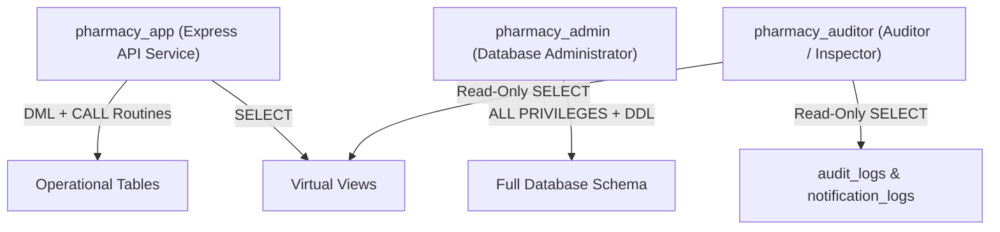

# My Pharmacist (VDC Store) — Enterprise Database Specification Document
**Module**: Advanced Database Management System (ADBMS)  
**Target RDBMS**: MySQL 8.0+ (InnoDB Storage Engine, UTF-8 MB4 Unicode)  
**Architecture**: Third Normal Form (3NF) Relational Model, ACID-Compliant Transactions, Least-Privilege Security  

---

## 1. Executive Summary & Object Inventory

The **My Pharmacist** database system (`pharmacy_db`) is designed for mission-critical pharmacy inventory, retail counter POS operations, patient prescription verification, wholesale procurement, and regulatory compliance.

### Database Object Roster Summary
| Category | Count | Key Description |
| :--- | :---: | :--- |
| **Relational Tables** | **22** | Normalized in 3NF with strict referential integrity (`ON DELETE RESTRICT/CASCADE/SET NULL`) and `CHECK` constraints. |
| **Database Views** | **14** | Virtual relations abstracting catalog search, financial accounting, inventory risk, and pharmacist workloads. |
| **Stored Procedures** | **11** | Encapsulated business transactions utilizing `START TRANSACTION`, row-level locking (`FOR UPDATE`), and FIFO lot deduction. |
| **Stored Functions** | **13** | Deterministic scalar routines for stock calculation, NIC format validation, price markups, and customer lifetime value. |
| **Database Triggers** | **8** | Automated integrity and audit triggers logging changes to `audit_logs` in JSON format. |
| **Scheduled Events** | **8** | Daemon background events for lot expiration quarantine, reservation cleanups, and audit archiving. |
| **Security Accounts** | **3** | Separation of duties (`pharmacy_app`, `pharmacy_admin`, `pharmacy_auditor`) with brute-force lockout rules. |

---

## 2. Relational Database Tables (22 Tables)

### Module 1: Medicine Catalog & Formulary
#### 1. `brands`
- **Purpose**: Stores pharmaceutical manufacturers, labs, and country of origin.
- **Key Columns**:
  - `brand_id` (INT, PK, AUTO_INCREMENT)
  - `brand_name` (VARCHAR(150), UNIQUE, NOT NULL)
  - `country_of_origin` (VARCHAR(100), DEFAULT 'Global')
  - `created_at` (TIMESTAMP)

#### 2. `medicine_categories`
- **Purpose**: Classifies medicines into categories and sub-departments via self-referencing hierarchy.
- **Key Columns**:
  - `category_id` (INT, PK, AUTO_INCREMENT)
  - `parent_category_id` (INT, NULL, FK -> `medicine_categories.category_id` ON DELETE SET NULL)
  - `category_name` (VARCHAR(100), UNIQUE, NOT NULL)
  - `description` (TEXT), `icon_name` (VARCHAR(50)), `image_url` (VARCHAR(500))

#### 3. `medicines`
- **Purpose**: Master drug formulary in 3NF detailing clinical attributes, pricing, discounts, and thresholds.
- **Key Columns**:
  - `medicine_id` (INT, PK, AUTO_INCREMENT)
  - `name` (VARCHAR(200), NOT NULL), `generic_name` (VARCHAR(200), NOT NULL)
  - `brand_id` (INT, FK -> `brands.brand_id` ON DELETE RESTRICT)
  - `category_id` (INT, FK -> `medicine_categories.category_id` ON DELETE RESTRICT)
  - `dosage_form` (VARCHAR(50)), `strength` (VARCHAR(50))
  - `unit_price` (DECIMAL(10,2), NOT NULL DEFAULT 0.00)
  - `discount_percent` (DECIMAL(5,2), NOT NULL DEFAULT 0.00)
  - `is_offer` (BOOLEAN, DEFAULT FALSE), `rating` (DECIMAL(2,1), DEFAULT 5.0)
  - `low_stock_threshold` (INT, NOT NULL DEFAULT 20)
  - `is_active` (BOOLEAN, DEFAULT TRUE)

---

### Module 2: Physical Inventory & Lot Tracking
#### 4. `suppliers`
- **Purpose**: Directory of licensed wholesale distributors and pharmaceutical representatives.
- **Key Columns**:
  - `supplier_id` (INT, PK, AUTO_INCREMENT)
  - `supplier_name` (VARCHAR(150), NOT NULL), `contact_person` (VARCHAR(100))
  - `phone` (VARCHAR(30)), `email` (VARCHAR(100)), `address` (TEXT), `is_active` (BOOLEAN)

#### 5. `medicine_batches`
- **Purpose**: Granular physical inventory lots tracking manufacture/expiry dates and stock levels.
- **Key Columns**:
  - `batch_id` (INT, PK, AUTO_INCREMENT)
  - `medicine_id` (INT, FK -> `medicines.medicine_id` ON DELETE CASCADE)
  - `supplier_id` (INT, FK -> `suppliers.supplier_id` ON DELETE RESTRICT)
  - `batch_number` (VARCHAR(80), UNIQUE, NOT NULL)
  - `manufacture_date` (DATE, NOT NULL), `expiry_date` (DATE, NOT NULL)
  - `quantity_received` (INT, NOT NULL), `stock_quantity` (INT, NOT NULL)
  - `reserved_quantity` (INT, NOT NULL DEFAULT 0)
  - `unit_cost` (DECIMAL(10,2), NOT NULL DEFAULT 0.00)
  - `status` (ENUM('active', 'quarantined', 'recalled', 'depleted'), DEFAULT 'active')
- **Constraints**:
  - `CHECK (quantity_received >= 0)`, `CHECK (stock_quantity >= 0)`
  - `CHECK (reserved_quantity >= 0 AND reserved_quantity <= stock_quantity)`
  - `CHECK (expiry_date > manufacture_date)`

#### 6. `stock_movements`
- **Purpose**: Immutable ledger recording all physical stock additions, dispensations, and adjustments.
- **Key Columns**:
  - `movement_id` (INT, PK, AUTO_INCREMENT)
  - `batch_id` (INT, FK -> `medicine_batches.batch_id` ON DELETE CASCADE)
  - `movement_type` (ENUM('RESTOCK', 'DISPENSED', 'ADJUSTMENT', 'RECALL', 'EXPIRED_DISCARD'))
  - `quantity_changed` (INT, NOT NULL), `reason` (VARCHAR(255)), `performed_by` (VARCHAR(100))
  - `movement_date` (TIMESTAMP DEFAULT CURRENT_TIMESTAMP)

---

### Module 3: Procurement & Wholesale Receiving
#### 7. `purchases`
- **Purpose**: Header record for wholesale inbound purchase shipments.
- **Key Columns**:
  - `purchase_id` (INT, PK, AUTO_INCREMENT)
  - `supplier_id` (INT, FK -> `suppliers.supplier_id` ON DELETE RESTRICT)
  - `invoice_number` (VARCHAR(80), UNIQUE, NOT NULL)
  - `purchase_date` (DATE, NOT NULL), `total_amount` (DECIMAL(10,2), NOT NULL)
  - `status` (ENUM('RECEIVED', 'PENDING', 'CANCELLED')), `received_by` (VARCHAR(100))

#### 8. `purchase_items`
- **Purpose**: Line item breakdown of inbound purchase invoices.
- **Key Columns**:
  - `purchase_item_id` (INT, PK, AUTO_INCREMENT)
  - `purchase_id` (INT, FK -> `purchases.purchase_id` ON DELETE CASCADE)
  - `medicine_id` (INT, FK -> `medicines.medicine_id` ON DELETE RESTRICT)
  - `batch_number` (VARCHAR(80)), `quantity` (INT > 0), `unit_cost` (DECIMAL(10,2) >= 0)
  - `subtotal` (DECIMAL(10,2)), `expiry_date` (DATE)

---

### Module 4: POS, Patients & Counter Dispensation
#### 9. `customers`
- **Purpose**: Patient profiles for online orders and repeat pharmacy dispensations.
- **Key Columns**:
  - `customer_id` (INT, PK, AUTO_INCREMENT)
  - `full_name` (VARCHAR(150), NOT NULL), `email` (VARCHAR(150), UNIQUE, NOT NULL)
  - `password_hash` (VARCHAR(255), NOT NULL), `contact_no` (VARCHAR(50)), `nic` (VARCHAR(50))
  - `patient_age` (VARCHAR(50)), `address` (TEXT), `is_active` (BOOLEAN)

#### 10. `sales`
- **Purpose**: Counter dispensary POS invoices and online order financial records.
- **Key Columns**:
  - `sale_id` (INT, PK, AUTO_INCREMENT)
  - `invoice_number` (VARCHAR(60), UNIQUE, NOT NULL)
  - `user_id` (INT, NULL, FK -> `users.user_id` ON DELETE SET NULL)
  - `customer_id` (INT, NULL, FK -> `customers.customer_id` ON DELETE SET NULL)
  - `patient_name` (VARCHAR(150), DEFAULT 'Walk-in Customer')
  - `prescription_ref` (VARCHAR(100), DEFAULT 'OTC')
  - `subtotal` (DECIMAL(10,2)), `discount_amount` (DECIMAL(10,2)), `tax_amount` (DECIMAL(10,2))
  - `total_amount` (DECIMAL(10,2) >= 0)
  - `payment_status` (ENUM('PAID', 'PARTIAL', 'REFUNDED'))
  - `sale_date` (TIMESTAMP DEFAULT CURRENT_TIMESTAMP)

#### 11. `sale_items`
- **Purpose**: Medication items included in each POS sale.
- **Key Columns**:
  - `sale_item_id` (INT, PK, AUTO_INCREMENT)
  - `sale_id` (INT, FK -> `sales.sale_id` ON DELETE CASCADE)
  - `medicine_id` (INT, FK -> `medicines.medicine_id` ON DELETE RESTRICT)
  - `quantity` (INT > 0), `unit_price` (DECIMAL(10,2)), `subtotal` (DECIMAL(10,2))

#### 12. `sale_item_batches`
- **Purpose**: 3NF associative bridge linking sale line items directly to specific physical lot deductions.
- **Key Columns**:
  - `allocation_id` (INT, PK, AUTO_INCREMENT)
  - `sale_item_id` (INT, FK -> `sale_items.sale_item_id` ON DELETE CASCADE)
  - `batch_id` (INT, FK -> `medicine_batches.batch_id` ON DELETE RESTRICT)
  - `quantity_allocated` (INT > 0)

#### 13. `payments`
- **Purpose**: Records tender amounts, payment methods, and change given per sale.
- **Key Columns**:
  - `payment_id` (INT, PK, AUTO_INCREMENT)
  - `sale_id` (INT, FK -> `sales.sale_id` ON DELETE CASCADE)
  - `payment_method` (ENUM('CASH', 'CARD', 'ONLINE', 'INSURANCE'))
  - `amount_paid` (DECIMAL(10,2) >= 0), `change_given` (DECIMAL(10,2) DEFAULT 0.00)
  - `reference_note` (VARCHAR(150)), `payment_date` (TIMESTAMP)

---

### Module 5: Online Prescriptions
#### 14. `prescription_orders`
- **Purpose**: Clinical workflow table for online prescription uploads and counter pickup fulfillment.
- **Key Columns**:
  - `order_id` (VARCHAR(50), PK)
  - `account_type` (ENUM('registered', 'guest'))
  - `customer_id` (INT, NULL, FK -> `customers.customer_id` ON DELETE SET NULL)
  - `your_name` (VARCHAR(150)), `your_email` (VARCHAR(150)), `patient_name` (VARCHAR(150))
  - `status` (ENUM('pending', 'accepted', 'rejected', 'dispensed') DEFAULT 'pending')
  - `pharmacist_name` (VARCHAR(150)), `ready_time` (VARCHAR(100)), `rejection_reason` (TEXT)

#### 15. `prescription_files`
- **Purpose**: Child table isolating file attachments from order metadata to preserve 1NF and InnoDB buffer pool efficiency.
- **Key Columns**:
  - `file_id` (INT, PK, AUTO_INCREMENT)
  - `order_id` (VARCHAR(50), FK -> `prescription_orders.order_id` ON DELETE CASCADE)
  - `file_path` (VARCHAR(255)), `file_name` (VARCHAR(255)), `file_type` (VARCHAR(50)), `file_size` (INT), `file_data` (LONGTEXT)

---

### Module 6: Customer Engagement & Feedback
#### 16. `promotions`
- **Purpose**: Promotional discount vouchers with validity bounds and minimum spend thresholds.
- **Key Columns**:
  - `promotion_id` (INT, PK, AUTO_INCREMENT)
  - `code` (VARCHAR(50), UNIQUE, NOT NULL), `title` (VARCHAR(150))
  - `discount_type` (ENUM('PERCENT', 'FIXED', 'FREE_DELIVERY'))
  - `discount_value` (DECIMAL(10,2)), `min_order_amount` (DECIMAL(10,2))
  - `is_active` (BOOLEAN), `valid_from` (DATE), `valid_until` (DATE)

#### 17. `customer_reviews`
- **Purpose**: Verified patient product ratings (1 to 5 stars) and clinical reviews.
- **Key Columns**:
  - `review_id` (INT, PK, AUTO_INCREMENT)
  - `customer_id` (INT, FK -> `customers.customer_id` ON DELETE SET NULL)
  - `medicine_id` (INT, FK -> `medicines.medicine_id` ON DELETE SET NULL)
  - `rating` (INT, CHECK 1 <= rating <= 5), `comment` (TEXT), `is_approved` (BOOLEAN)

#### 18. `inquiries`
- **Purpose**: Patient questions regarding medications and clinical counseling.
- **Key Columns**:
  - `inquiry_id` (INT, PK, AUTO_INCREMENT)
  - `reference_code` (VARCHAR(50), UNIQUE, NOT NULL), `customer_id` (INT, FK -> `customers.customer_id`)
  - `name` (VARCHAR(150)), `email` (VARCHAR(150)), `medicine_query` (VARCHAR(200)), `message` (TEXT)
  - `status` (ENUM('NEW', 'IN_REVIEW', 'RESOLVED')), `staff_notes` (TEXT), `responded_by` (VARCHAR(100))

---

### Module 7: Core Administration & System Audit
#### 19. `users`
- **Purpose**: Internal system operators (Staff Pharmacists, Administrators).
- **Key Columns**:
  - `user_id` (INT, PK, AUTO_INCREMENT)
  - `username` (VARCHAR(50), UNIQUE, NOT NULL), `email` (VARCHAR(100), UNIQUE, NOT NULL)
  - `password_hash` (VARCHAR(255), NOT NULL), `role` (ENUM('ADMIN', 'PHARMACIST'))
  - `full_name` (VARCHAR(100)), `is_active` (BOOLEAN)

#### 20. `pharmacy_settings`
- **Purpose**: Configurable global pharmacy metadata (contact numbers, opening hours, tax rules).
- **Key Columns**:
  - `setting_key` (VARCHAR(50), PK), `setting_value` (TEXT NOT NULL), `is_public` (BOOLEAN)

#### 21. `audit_logs`
- **Purpose**: System-wide audit trail capturing JSON before-and-after snapshots of critical record modifications.
- **Key Columns**:
  - `log_id` (INT, PK, AUTO_INCREMENT), `table_name` (VARCHAR(50)), `operation` (ENUM('INSERT', 'UPDATE', 'DELETE'))
  - `record_id` (INT), `old_value` (JSON), `new_value` (JSON), `performed_by` (VARCHAR(100)), `timestamp` (TIMESTAMP)

#### 22. `notification_logs`
- **Purpose**: Relational audit log for customer email dispatches and fulfillment alerts.
- **Key Columns**:
  - `notification_id` (INT, PK, AUTO_INCREMENT), `order_id` (VARCHAR(50), FK -> `prescription_orders`), `recipient_email` (VARCHAR(150))
  - `subject` (VARCHAR(255)), `message_body` (TEXT), `status` (ENUM('SENT', 'FAILED', 'PENDING')), `sent_at` (TIMESTAMP)

---

## 3. Database Views (14 Views)

Virtual tables encapsulating complex analytical queries and providing decoupled, read-only abstractions:

1. **`v_medicine_catalog`**: Joins `medicines`, `brands`, and `medicine_categories` with active stock summaries and effective discount pricing.
2. **`v_medicine_availability`**: Aggregates physical batch lots to present instant stock states (`In Stock`, `Low Stock`, `Out of Stock`).
3. **`v_low_stock_alerts`**: Filters medicines where total saleable stock is at or below `low_stock_threshold`.
4. **`v_expiring_batches`**: Identifies batch lots expiring within 90 days, already expired, or quarantined.
5. **`v_daily_sales`**: Aggregates daily counter sales, orders count, gross subtotal, discounts, tax, and net revenue.
6. **`v_monthly_sales`**: Monthly financial reporting view computing revenue and volume trends.
7. **`v_sales_by_medicine`**: Formulary demand report aggregating total units dispensed and total revenue generated per drug.
8. **`v_payment_summary`**: Summarizes payment methods (`CASH`, `CARD`, `ONLINE`, `INSURANCE`) by date.
9. **`v_active_promotions`**: Filters currently valid promotions comparing system `CURDATE()` against validity windows.
10. **`v_approved_reviews`**: Publicly exposed testimonials approved by moderators.
11. **`v_customer_purchase_history`**: Comprehensive clinical review of all historical counter sales and dispensed drugs per patient.
12. **`v_supplier_order_performance`**: Tracks wholesale procurement totals, invoices, and fulfillment performance per supplier.
13. **`v_prescription_fulfillment_pipeline`**: High-level workflow view monitoring prescription requests across stages (`pending`, `accepted`, `rejected`, `dispensed`).
14. **`v_pharmacist_dispensing_workload`**: Audit view summarizing counter sales processed and total revenue handled per staff pharmacist.

---

## 4. Stored Procedures (11 Procedures)

### 1. `sp_create_pos_sale`
- **Signature**:
  ```sql
  sp_create_pos_sale(
      IN p_user_id INT,
      IN p_customer_id INT,
      IN p_patient_name VARCHAR(150),
      IN p_prescription_ref VARCHAR(100),
      IN p_discount_amount DECIMAL(10,2),
      IN p_tax_amount DECIMAL(10,2),
      IN p_payment_method VARCHAR(20),
      IN p_amount_paid DECIMAL(10,2),
      IN p_items_json JSON,
      OUT p_sale_id INT,
      OUT p_invoice_number VARCHAR(60),
      OUT p_change_given DECIMAL(10,2)
  )
  ```
- **Description**: Atomic POS checkout routine. Parses incoming JSON items, locks matching batches using `SELECT ... FOR UPDATE`, deducts stock on a **First-In, First-Out (FIFO)** expiry basis, creates `sales`, `sale_items`, `sale_item_batches`, and `payments` records, and creates corresponding `stock_movements` entries. Rolls back completely on stock deficit.

### 2. `sp_update_batch_stock`
- **Signature**: `(IN p_batch_id INT, IN p_quantity_change INT, IN p_movement_type VARCHAR(20), IN p_reason VARCHAR(255), IN p_performed_by VARCHAR(100))`
- **Description**: Adjusts batch stock, enforces non-negative constraints, and appends a `stock_movements` record.

### 3. `sp_receive_new_batch`
- **Signature**: `(IN p_medicine_id INT, IN p_supplier_id INT, IN p_batch_number VARCHAR(80), IN p_manufacture_date DATE, IN p_expiry_date DATE, IN p_quantity INT, IN p_unit_cost DECIMAL(10,2), IN p_received_by VARCHAR(100), OUT p_batch_id INT)`
- **Description**: Inserts a new physical batch lot and automatically logs the initial `RESTOCK` movement.

### 4. `sp_get_inventory_summary`
- **Signature**: `()`
- **Description**: Returns a consolidated inventory health result set: Total Active Medicines, Total Stock Units, Valuation, Low Stock Alerts, and Expiring Lots.

### 5. `sp_quarantine_batch`
- **Signature**: `(IN p_batch_id INT, IN p_reason VARCHAR(255), IN p_performed_by VARCHAR(100))`
- **Description**: Flags a batch as `quarantined`, removing it from saleable inventory and recording a `RECALL` entry in `stock_movements`.

### 6. `sp_approve_prescription_order`
- **Signature**: `(IN p_order_id VARCHAR(50), IN p_pharmacist_name VARCHAR(150), IN p_ready_time VARCHAR(100), IN p_confirmation_message TEXT)`
- **Description**: Marks a prescription order as `accepted`, sets pickup ready time, and stages an acceptance dispatch in `notification_logs`.

### 7. `sp_reject_prescription_order`
- **Signature**: `(IN p_order_id VARCHAR(50), IN p_pharmacist_name VARCHAR(150), IN p_rejection_reason TEXT)`
- **Description**: Marks a prescription order as `rejected` with clinical reasoning and writes an alert to `notification_logs`.

### 8. `sp_dispense_prescription_order`
- **Signature**: `(IN p_order_id VARCHAR(50), IN p_pharmacist_name VARCHAR(150))`
- **Description**: Advances prescription order status to `dispensed` upon patient pickup.

### 9. `sp_register_patient_customer`
- **Signature**: `(IN p_full_name VARCHAR(150), IN p_email VARCHAR(150), IN p_password_hash VARCHAR(255), IN p_contact_no VARCHAR(50), IN p_patient_age VARCHAR(50), IN p_nic VARCHAR(50), IN p_address TEXT, OUT p_customer_id INT)`
- **Description**: Creates customer records with email uniqueness checks and NIC sanitization.

### 10. `sp_apply_promotional_coupon`
- **Signature**: `(IN p_coupon_code VARCHAR(50), IN p_order_subtotal DECIMAL(10,2), OUT p_is_valid BOOLEAN, OUT p_discount_amount DECIMAL(10,2), OUT p_message VARCHAR(255))`
- **Description**: Checks promo code validity, expiration date, and minimum subtotal; returns calculated discount amount.

### 11. `sp_process_inquiry_response`
- **Signature**: `(IN p_inquiry_id INT, IN p_staff_name VARCHAR(100), IN p_response_notes TEXT)`
- **Description**: Closes patient inquiries, updates status to `RESOLVED`, and logs staff counseling notes.

---

## 5. Stored Functions (13 Functions)

| Function | Return Type | Characteristics | Purpose |
| :--- | :---: | :---: | :--- |
| `fn_calculate_available_stock(p_medicine_id INT)` | `INT` | DETERMINISTIC, READS SQL | Calculates saleable unreserved stock for non-expired, active lots. |
| `fn_get_availability_status(p_medicine_id INT)` | `VARCHAR(20)` | DETERMINISTIC, READS SQL | Returns `'In Stock'`, `'Low Stock'`, or `'Out of Stock'`. |
| `fn_calculate_discounted_price(p_unit_price, p_discount_percent)` | `DECIMAL(10,2)` | DETERMINISTIC, NO SQL | Computes final price after applying percentage discounts. |
| `fn_calculate_batch_remaining_days(p_batch_id INT)` | `INT` | DETERMINISTIC, READS SQL | Returns days remaining until lot expiration (`DATEDIFF`). |
| `fn_is_batch_expired(p_batch_id INT)` | `BOOLEAN` | DETERMINISTIC, READS SQL | Returns `TRUE` if batch expiry date is in the past. |
| `fn_get_medicine_total_batches(p_medicine_id INT)` | `INT` | DETERMINISTIC, READS SQL | Counts active batches associated with a medicine. |
| `fn_calculate_customer_lifetime_value(p_customer_id INT)` | `DECIMAL(10,2)` | DETERMINISTIC, READS SQL | Sums all completed purchase amounts for a given patient. |
| `fn_get_customer_order_count(p_customer_id INT)` | `INT` | DETERMINISTIC, READS SQL | Counts total completed transactions for a given patient. |
| `fn_calculate_order_tax(p_subtotal, p_tax_rate)` | `DECIMAL(10,2)` | DETERMINISTIC, NO SQL | Calculates statutory healthcare/sales tax amount. |
| `fn_get_batch_profit_margin(p_batch_id INT)` | `DECIMAL(5,2)` | DETERMINISTIC, READS SQL | Computes profit margin percentage between wholesale cost and retail price. |
| `fn_validate_nic_format(p_nic VARCHAR(50))` | `BOOLEAN` | DETERMINISTIC, NO SQL | Validates Sri Lankan National Identity Card regex formats (old 9-digit + V/X or new 12-digit format). |
| `fn_get_prescriptions_count_by_status(p_status)` | `INT` | DETERMINISTIC, READS SQL | Counts prescription orders in a specific status. |
| `fn_get_pharmacist_total_sales(p_user_id, p_date)` | `DECIMAL(10,2)` | DETERMINISTIC, READS SQL | Calculates gross sales value handled by a specific cashier on a date. |

---

## 6. Database Triggers (8 Triggers)

1. **`trg_after_batch_stock_update`** (`AFTER UPDATE ON medicine_batches`):
   - Captures old vs. new stock quantities and serializes state snapshots into `audit_logs` as JSON.
2. **`trg_before_batch_insert`** (`BEFORE INSERT ON medicine_batches`):
   - Integrity constraint ensuring `expiry_date > manufacture_date`. Throws `SQLSTATE '45000'` on violation.
3. **`trg_before_batch_update_depleted`** (`BEFORE UPDATE ON medicine_batches`):
   - Automatically switches lot status to `depleted` when `stock_quantity` reaches 0.
4. **`trg_after_sale_insert_log`** (`AFTER INSERT ON sales`):
   - Logs newly generated counter invoices into `audit_logs` for financial accountability.
5. **`trg_before_medicine_price_check`** (`BEFORE INSERT/UPDATE ON medicines`):
   - Validates that `unit_price >= 0` and `discount_percent` is between 0.00% and 100.00%.
6. **`trg_after_prescription_status_audit`** (`AFTER UPDATE ON prescription_orders`):
   - Automatically generates audit logs whenever prescription status transitions.
7. **`trg_before_customer_insert_sanitize`** (`BEFORE INSERT ON customers`):
   - Trims leading/trailing whitespace and normalizes email addresses to lowercase.
8. **`trg_after_purchase_item_insert`** (`AFTER INSERT ON purchase_items`):
   - Recalculates and updates the cumulative `total_amount` in the parent `purchases` record.

---

## 7. Scheduled Events (8 Background Jobs)

Managed by the MySQL Event Scheduler (`SET GLOBAL event_scheduler = ON`):

1. **`ev_daily_quarantine_expired_batches`** (Daily @ 00:00):
   - Automatically flags batches past their expiration date as `quarantined` and deactivates expired promotions.
2. **`ev_weekly_system_maintenance`** (Weekly on Sunday @ 03:00):
   - Purges sent notification logs older than 90 days to prevent unbounded table growth.
3. **`ev_daily_low_stock_notification`** (Daily @ 08:00):
   - Scans formulary for depleted items and logs system warning alerts in `notification_logs`.
4. **`ev_daily_expiry_warning_audit`** (Daily @ 08:30):
   - Identifies active batches expiring within 30 days and stages notifications for pharmacy procurement staff.
5. **`ev_hourly_stale_reservation_cleanup`** (Hourly):
   - Identifies abandoned cart reservations and releases `reserved_quantity` back into saleable stock.
6. **`ev_monthly_sales_summary_archive`** (Monthly on 1st @ 01:00):
   - Generates monthly financial aggregates and saves archival summaries into `audit_logs`.
7. **`ev_daily_auto_resolve_stale_inquiries`** (Daily @ 23:00):
   - Auto-resolves customer inquiries that have remained inactive for over 30 days.
8. **`ev_daily_reset_brute_force_locks`** (Daily @ 04:00):
   - Resets temporary account locks in accordance with security maintenance policies.

---

## 8. Database Security & Access Control (DCL)

The database implements strict Principle of Least Privilege (PoLP) and Role-Based Access Control (RBAC):



### User Roles & Privilege Matrix
1. **`pharmacy_app`@`localhost` (Runtime Service Account)**:
   - **Permissions**: `SELECT, INSERT, UPDATE, DELETE` on operational tables; `EXECUTE` on stored procedures/functions; `SELECT` on views.
   - **Restrictions**: Strictly denied all DDL operations (`DROP`, `ALTER`, `CREATE TABLE`, `TRUNCATE`).
   - **Throttling**: `MAX_QUERIES_PER_HOUR 20000`, `MAX_CONNECTIONS_PER_HOUR 2000`, `MAX_USER_CONNECTIONS 50`.
   - **Brute-Force Policy**: `FAILED_LOGIN_ATTEMPTS 5`, `PASSWORD_LOCK_TIME 1 DAY`.

2. **`pharmacy_admin`@`localhost` (DBA Account)**:
   - **Permissions**: `ALL PRIVILEGES` with `GRANT OPTION`.
   - **Restrictions**: 90-day password rotation requirement (`PASSWORD EXPIRE INTERVAL 90 DAY`).

3. **`pharmacy_auditor`@`localhost` (Regulatory Compliance Account)**:
   - **Permissions**: Strictly `SELECT` on analytical views, `audit_logs`, and `notification_logs`.
   - **Restrictions**: No write access to any table.
