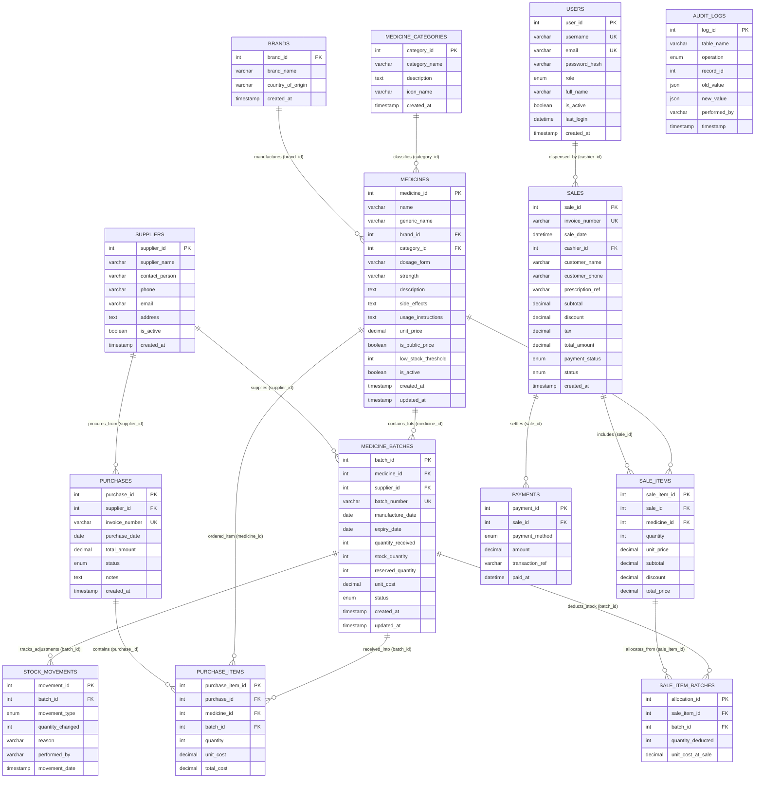

# My Pharmacist Pharmacy Management System — Entity-Relationship (ER) Diagram & Schema Specification

This document presents the complete relational architecture of the **My Pharmacist** pharmacy management system, modeled strictly in **Third Normal Form (3NF)** for MySQL 8.0+.

---

## 1. Mermaid Entity-Relationship Diagram

---

## 2. Relational Table Specifications

### 2.1 `brands`
- **Purpose:** Stores pharmaceutical companies and manufacturing labs.
- **Attributes:** `brand_id` (PK), `brand_name` (UK), `country_of_origin`, `created_at`.

### 2.2 `medicine_categories`
- **Purpose:** Therapeutic classification (Antibiotics, Analgesics, Cardiovascular, etc.).
- **Attributes:** `category_id` (PK), `category_name` (UK), `description`, `icon_name`, `created_at`.

### 2.3 `suppliers`
- **Purpose:** Wholesalers and pharmaceutical logistics distributors.
- **Attributes:** `supplier_id` (PK), `supplier_name`, `contact_person`, `phone`, `email`, `address`, `is_active`, `created_at`.

### 2.4 `medicines`
- **Purpose:** Formulary master records for active molecules, packaging, retail prices, and clinical notes.
- **Attributes:** `medicine_id` (PK), `name`, `generic_name`, `brand_id` (FK), `category_id` (FK), `dosage_form`, `strength`, `description`, `side_effects`, `usage_instructions`, `unit_price`, `is_public_price`, `low_stock_threshold`, `is_active`, `created_at`, `updated_at`.

### 2.5 `medicine_batches`
- **Purpose:** Granular lot tracking, expiration dates, wholesale unit costs, and physical dispensary stock.
- **Attributes:** `batch_id` (PK), `medicine_id` (FK), `supplier_id` (FK), `batch_number` (UK), `manufacture_date`, `expiry_date`, `quantity_received`, `stock_quantity`, `reserved_quantity`, `unit_cost`, `status` (`active`, `quarantined`, `recalled`, `depleted`), `created_at`, `updated_at`.

### 2.6 `stock_movements`
- **Purpose:** Transactional ledger of batch quantity adjustments (Restock, Dispensed, Count Adjustment, Recall).
- **Attributes:** `movement_id` (PK), `batch_id` (FK), `movement_type`, `quantity_changed`, `reason`, `performed_by`, `movement_date`.

### 2.7 `purchases` & `purchase_items`
- **Purpose:** Inward supplier purchase order ledger with itemized wholesale procurement lines and batch mapping.
- **Attributes:** 
  - `purchases`: `purchase_id` (PK), `supplier_id` (FK), `invoice_number`, `purchase_date`, `total_amount`, `status`, `notes`.
  - `purchase_items`: `purchase_item_id` (PK), `purchase_id` (FK), `medicine_id` (FK), `batch_id` (FK), `quantity`, `unit_cost`, `total_cost`.

### 2.8 `sales` & `sale_items` & `sale_item_batches`
- **Purpose:** Outward POS dispensary transactions. In full 3NF, multi-batch deductions for a single line item are stored in `sale_item_batches`.
- **Attributes:**
  - `sales`: `sale_id` (PK), `invoice_number` (UK), `sale_date`, `cashier_id` (FK), `customer_name`, `customer_phone`, `prescription_ref`, `subtotal`, `discount`, `tax`, `total_amount`, `payment_status`, `status`.
  - `sale_items`: `sale_item_id` (PK), `sale_id` (FK), `medicine_id` (FK), `quantity`, `unit_price`, `subtotal`, `discount`, `total_price`.
  - `sale_item_batches`: `allocation_id` (PK), `sale_item_id` (FK), `batch_id` (FK), `quantity_deducted`, `unit_cost_at_sale`.

### 2.9 `payments`
- **Purpose:** Multi-method settlement records (Cash, Card, Online Bank Transfer) per sale invoice.
- **Attributes:** `payment_id` (PK), `sale_id` (FK), `payment_method`, `amount`, `transaction_ref`, `paid_at`.

### 2.10 `users`
- **Purpose:** Staff accounts with role-based access control (ADMIN, PHARMACIST, CASHIER) and bcrypt password hashing.
- **Attributes:** `user_id` (PK), `username` (UK), `email` (UK), `password_hash`, `role`, `full_name`, `is_active`, `last_login`, `created_at`.

### 2.11 `audit_logs`
- **Purpose:** System-wide trigger-generated historical snapshot log tracking regulatory state changes.

---

## 3. Third Normal Form (3NF) Compliance Analysis

1. **1NF:** Every column contains atomic values, unique primary keys exist on all tables, and repeating groups are separated into junction tables (`sale_items`, `purchase_items`).
2. **2NF:** No partial dependencies exist. All non-key attributes fully depend on the complete primary key of each entity.
3. **3NF:** No transitive dependencies. Supplier details depend on `supplier_id`, manufacturer origin depends on `brand_id`, payment details depend on `payment_id`, and batch stock allocations depend on `allocation_id`.
