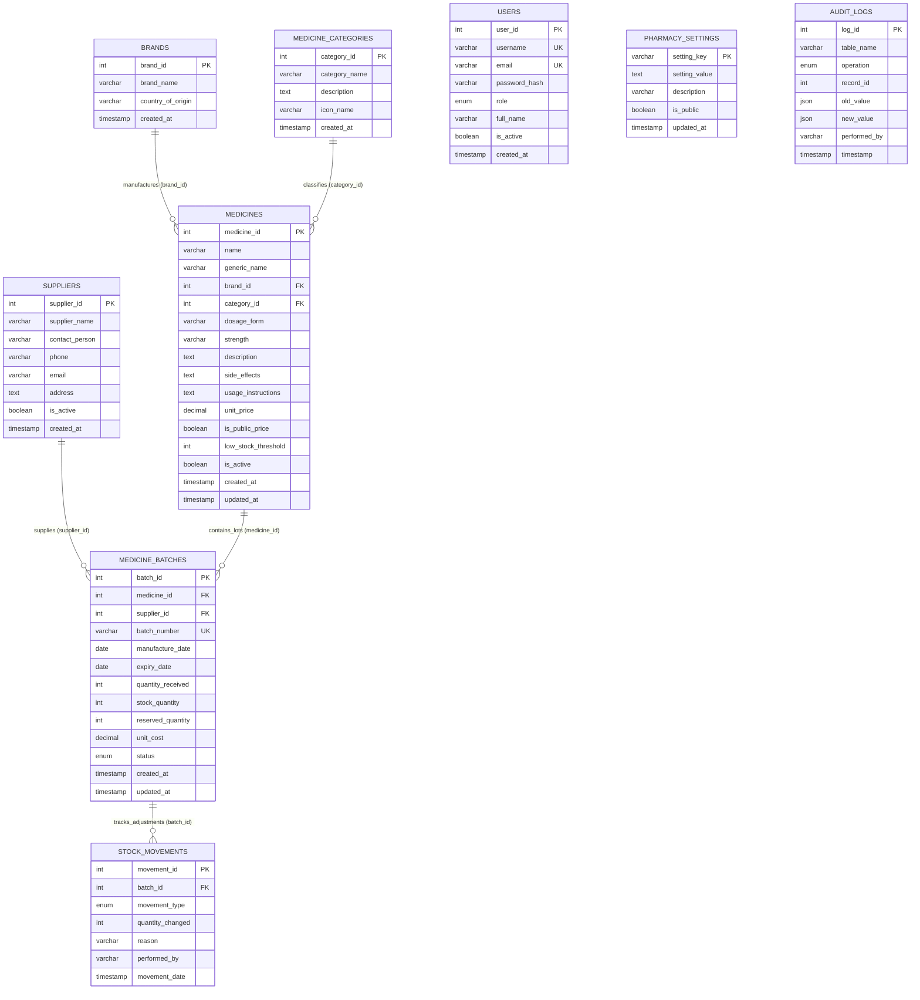

# VDC Store Pharmacy Management System — Entity-Relationship (ER) Diagram & Schema Specification

This document presents the relational architecture of the **VDC Store Pharmacy Management System**, modeled strictly in **Third Normal Form (3NF)** for MySQL 8.0+.

---

## 1. Mermaid Entity-Relationship Diagram

---

## 2. Relational Table Specifications

### 2.1 `brands`
- **Purpose:** Stores pharmaceutical companies and manufacturing labs.
- **Attributes:**
  - `brand_id`: INT AUTO_INCREMENT, Primary Key
  - `brand_name`: VARCHAR(150) NOT NULL UNIQUE
  - `country_of_origin`: VARCHAR(100) DEFAULT 'Global'
  - `created_at`: TIMESTAMP DEFAULT CURRENT_TIMESTAMP

### 2.2 `medicine_categories`
- **Purpose:** Therapeutic classification (e.g., Antibiotics, Analgesics, Cardiovascular, etc.).
- **Attributes:**
  - `category_id`: INT AUTO_INCREMENT, Primary Key
  - `category_name`: VARCHAR(100) NOT NULL UNIQUE
  - `description`: TEXT
  - `icon_name`: VARCHAR(50) DEFAULT 'Pill'
  - `created_at`: TIMESTAMP DEFAULT CURRENT_TIMESTAMP

### 2.3 `suppliers`
- **Purpose:** Wholesalers and pharmaceutical logistics distributors. (Staff internal only).
- **Attributes:**
  - `supplier_id`: INT AUTO_INCREMENT, Primary Key
  - `supplier_name`: VARCHAR(150) NOT NULL
  - `contact_person`: VARCHAR(100)
  - `phone`: VARCHAR(30)
  - `email`: VARCHAR(100)
  - `address`: TEXT
  - `is_active`: BOOLEAN DEFAULT TRUE

### 2.4 `medicines`
- **Purpose:** Catalog master records for formulations, chemical molecules, and clinical advice.
- **Attributes:**
  - `medicine_id`: INT AUTO_INCREMENT, Primary Key
  - `name`: VARCHAR(200) NOT NULL (Brand or trade name)
  - `generic_name`: VARCHAR(200) NOT NULL (Chemical active substance)
  - `brand_id`: INT NOT NULL, Foreign Key &rarr; `brands(brand_id)`
  - `category_id`: INT NOT NULL, Foreign Key &rarr; `medicine_categories(category_id)`
  - `dosage_form`: VARCHAR(50) NOT NULL (Tablet, Syrup, Capsule, etc.)
  - `strength`: VARCHAR(50) NOT NULL (e.g. 500mg, 100mcg)
  - `description`: TEXT
  - `side_effects`: TEXT
  - `usage_instructions`: TEXT
  - `unit_price`: DECIMAL(10,2) NOT NULL DEFAULT 0.00
  - `is_public_price`: BOOLEAN DEFAULT TRUE
  - `low_stock_threshold`: INT NOT NULL DEFAULT 20
  - `is_active`: BOOLEAN DEFAULT TRUE

### 2.5 `medicine_batches`
- **Purpose:** Granular lot tracking, expiration management, and actual physical stock levels.
- **Attributes:**
  - `batch_id`: INT AUTO_INCREMENT, Primary Key
  - `medicine_id`: INT NOT NULL, Foreign Key &rarr; `medicines(medicine_id)`
  - `supplier_id`: INT NOT NULL, Foreign Key &rarr; `suppliers(supplier_id)`
  - `batch_number`: VARCHAR(80) NOT NULL UNIQUE
  - `manufacture_date`: DATE NOT NULL
  - `expiry_date`: DATE NOT NULL (Constraint: `expiry_date > manufacture_date`)
  - `quantity_received`: INT NOT NULL (Constraint: `>= 0`)
  - `stock_quantity`: INT NOT NULL (Constraint: `>= 0`)
  - `reserved_quantity`: INT NOT NULL DEFAULT 0
  - `unit_cost`: DECIMAL(10,2) NOT NULL DEFAULT 0.00
  - `status`: ENUM('active', 'quarantined', 'recalled', 'depleted') DEFAULT 'active'

### 2.6 `stock_movements`
- **Purpose:** Complete transactional record of batch quantity changes.
- **Attributes:**
  - `movement_id`: INT AUTO_INCREMENT, Primary Key
  - `batch_id`: INT NOT NULL, Foreign Key &rarr; `medicine_batches(batch_id)`
  - `movement_type`: ENUM('RESTOCK', 'DISPENSED', 'ADJUSTMENT', 'RECALL', 'EXPIRED_DISCARD')
  - `quantity_changed`: INT NOT NULL
  - `reason`: VARCHAR(255)
  - `performed_by`: VARCHAR(100)
  - `movement_date`: TIMESTAMP DEFAULT CURRENT_TIMESTAMP

### 2.7 `users`
- **Purpose:** Role-based staff authentication (ADMIN, PHARMACIST).
- **Attributes:**
  - `user_id`: INT AUTO_INCREMENT, Primary Key
  - `username`: VARCHAR(50) NOT NULL UNIQUE
  - `email`: VARCHAR(100) NOT NULL UNIQUE
  - `password_hash`: VARCHAR(255) NOT NULL (Bcrypt)
  - `role`: ENUM('ADMIN', 'PHARMACIST') NOT NULL
  - `full_name`: VARCHAR(100) NOT NULL
  - `is_active`: BOOLEAN DEFAULT TRUE

### 2.8 `pharmacy_settings`
- **Purpose:** Dynamic configuration of store name, contact numbers, address, and hours.
- **Attributes:**
  - `setting_key`: VARCHAR(50) Primary Key
  - `setting_value`: TEXT NOT NULL
  - `description`: VARCHAR(255)
  - `is_public`: BOOLEAN DEFAULT FALSE

### 2.9 `audit_logs`
- **Purpose:** Automated audit log populated by database trigger `trg_after_batch_stock_update`.
- **Attributes:**
  - `log_id`: INT AUTO_INCREMENT, Primary Key
  - `table_name`: VARCHAR(50) NOT NULL
  - `operation`: ENUM('INSERT', 'UPDATE', 'DELETE') NOT NULL
  - `record_id`: INT NOT NULL
  - `old_value`: JSON
  - `new_value`: JSON
  - `performed_by`: VARCHAR(100)
  - `timestamp`: TIMESTAMP DEFAULT CURRENT_TIMESTAMP

---

## 3. Third Normal Form (3NF) Compliance Analysis

1. **First Normal Form (1NF):**
   - All columns contain atomic, indivisible values.
   - Primary keys uniquely identify every record in each table.
   - Repeating groups are eliminated.

2. **Second Normal Form (2NF):**
   - The schema is in 1NF.
   - Every non-key attribute is fully functionally dependent on the primary key (no partial key dependencies exist).

3. **Third Normal Form (3NF):**
   - The schema is in 2NF.
   - All transitive dependencies have been removed:
     - Manufacturer country depends on `brand_id`, so it resides in `brands`, not in `medicines`.
     - Category descriptions depend on `category_id`, residing in `medicine_categories`.
     - Supplier details depend on `supplier_id`, residing in `suppliers`, completely separated from medicine definitions and public customer views.
